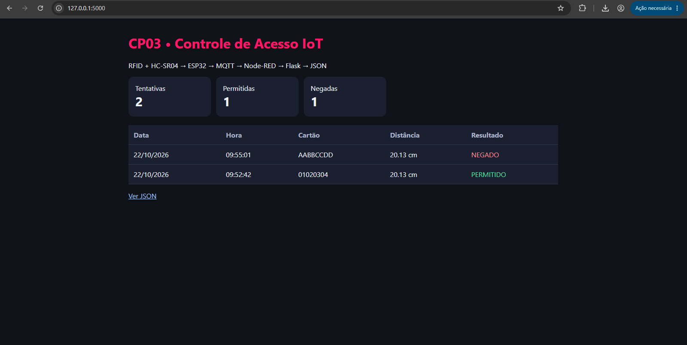
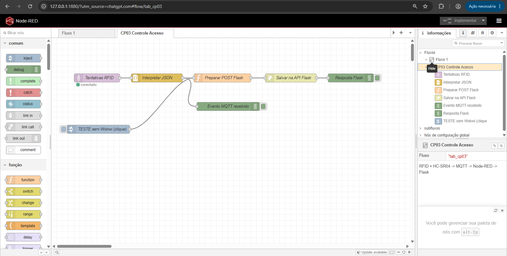
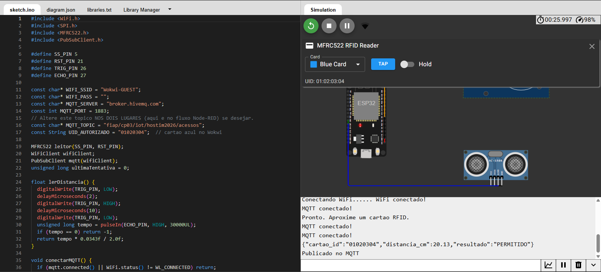
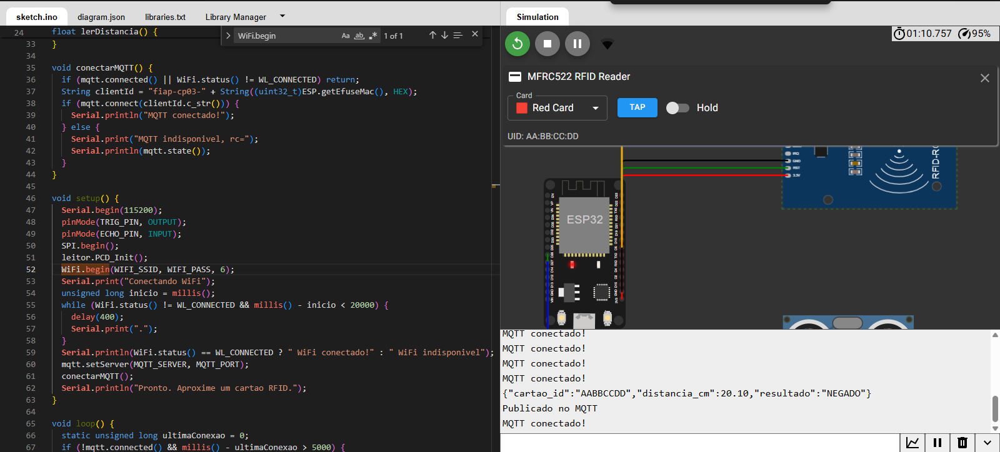
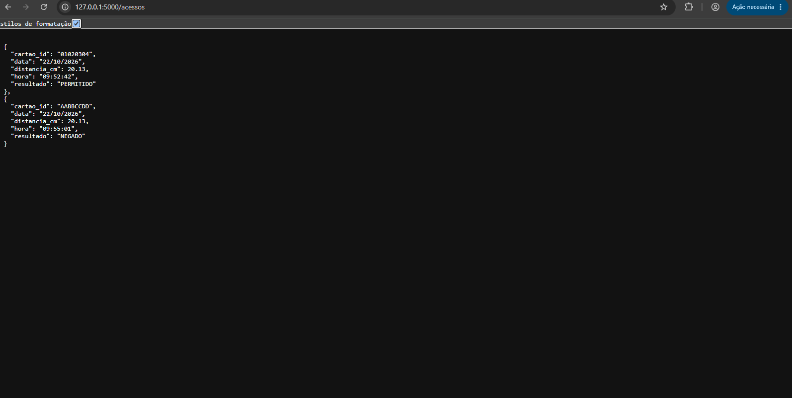

# Controle de acesso IoT com RFID e ESP32

Projeto desenvolvido em equipe para o **Checkpoint 03 de IoT da FIAP**. A ideia é simples: identificar um cartão RFID, medir a distância de quem está tentando acessar e registrar se a entrada foi permitida ou negada.

O sistema foi montado e testado no **Wokwi**, com os dados enviados por **MQTT** ao **Node-RED** e encaminhados para uma **API em Flask**. A API salva cada tentativa em JSON e disponibiliza um dashboard para consultar os registros.

**[Abrir a simulação no Wokwi](https://wokwi.com/projects/478583264905670657)**

## Como funciona

O acesso só é permitido quando as duas condições são verdadeiras:

- O cartão RFID está autorizado (no exemplo, o cartão azul com UID `01020304`).
- A distância medida pelo HC-SR04 é **menor que 30 cm**.

Qualquer outro cenário retorna `NEGADO`, inclusive quando o sensor não consegue medir a distância.

```text
Cartão RFID + HC-SR04
          ↓
         ESP32
          ↓  MQTT
        Node-RED
          ↓  HTTP POST
       API Flask
          ↓
     Arquivo JSON
          ↓
     Dashboard web
```

## Resultado

Nos testes da simulação, o cartão azul a aproximadamente 20 cm foi autorizado, enquanto o cartão vermelho, na mesma distância, teve o acesso negado. As duas tentativas chegaram até o dashboard e foram gravadas em JSON.



### Fluxo do Node-RED



<details>
<summary>Mais imagens dos testes</summary>

**Acesso permitido no Wokwi**



**Acesso negado no Wokwi**



**Registros gravados pela API**



</details>

## Tecnologias

- ESP32, leitor RFID MFRC522 e sensor ultrassônico HC-SR04
- Arduino/C++ na simulação Wokwi
- MQTT usando o broker público HiveMQ
- Node-RED para receber e encaminhar as mensagens
- Python + Flask para armazenar registros e disponibilizar o dashboard
- JSON para os dados das tentativas

## Estrutura do repositório

```text
.
├── wokwi/
│   ├── sketch.ino        # Código do ESP32
│   ├── diagram.json      # Componentes e conexões no Wokwi
│   └── libraries.txt     # Bibliotecas usadas
├── node-red/
│   └── fluxo.json        # Fluxo para importar no Node-RED
├── api/
│   ├── app.py            # API Flask e dashboard
│   └── requirements.txt  # Dependência Python
├── exemplos/
│   └── acessos-exemplo.json
└── imagens/              # Prints reais dos testes
```

## Como executar

### 1. Iniciar a API

Tenha o Python instalado. Abra um terminal na pasta `api` e execute:

```bash
python -m pip install -r requirements.txt
python app.py
```

Acesse **http://127.0.0.1:5000** para abrir o dashboard. Os registros em JSON ficam em **http://127.0.0.1:5000/acessos**.

O arquivo `api/acessos.json` é criado automaticamente quando a primeira tentativa é recebida. Uma amostra dos testes está em `exemplos/acessos-exemplo.json`.

### 2. Iniciar o Node-RED

Em outro terminal, com o Node-RED já instalado:

```bash
node-red
```

Abra **http://127.0.0.1:1880** no navegador. Vá ao menu **☰ > Importar**, selecione `node-red/fluxo.json` e clique em **Implementar**.

O fluxo está configurado para escutar o tópico MQTT `fiap/cp03/iot/hostim2026/acessos` no broker `broker.hivemq.com:1883` e fazer `POST` para a API local em `http://127.0.0.1:5000/acessos`.

Se quiser testar apenas Node-RED + Flask, há um nó chamado **TESTE sem Wokwi (clique)**, que envia um registro de exemplo.

### 3. Executar a simulação no Wokwi

Você pode abrir o **[projeto já salvo](https://wokwi.com/projects/478583264905670657)** ou criar um ESP32 novo no Wokwi e copiar os arquivos da pasta `wokwi` para as abas de mesmo nome.

As bibliotecas utilizadas são `MFRC522` e `PubSubClient`.

Inicie a simulação e aguarde a conexão ao Wi-Fi e ao MQTT. Clique no leitor RFID e use **Tap** com o cartão azul ou vermelho. Também é possível alterar a distância clicando no sensor ultrassônico.

Com tudo rodando, a tabela do dashboard deve atualizar automaticamente.

## Observações

Este é um **protótipo acadêmico em ambiente simulado**, não um sistema de controle de acesso pronto para instalação real. A autorização utiliza um UID fixo e o MQTT está em um broker público, sem autenticação e sem criptografia: não use cartões reais, dados pessoais ou informações sensíveis nessa configuração.

Para reproduzir localmente, Flask e Node-RED devem rodar no **mesmo computador**. O endereço `127.0.0.1` só funciona na própria máquina; o link do Wokwi é público, mas o dashboard local não é. Se alterar o tópico MQTT, atualize tanto `wokwi/sketch.ino` quanto o nó de entrada do Node-RED.

O projeto foi desenvolvido com apoio de ferramentas de IA para implementação e organização do código, com testes realizados na simulação.
